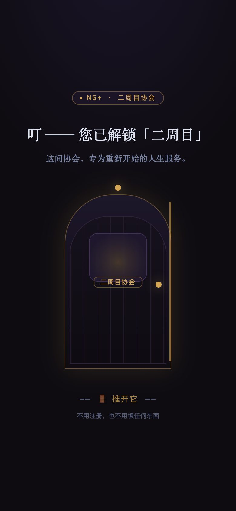
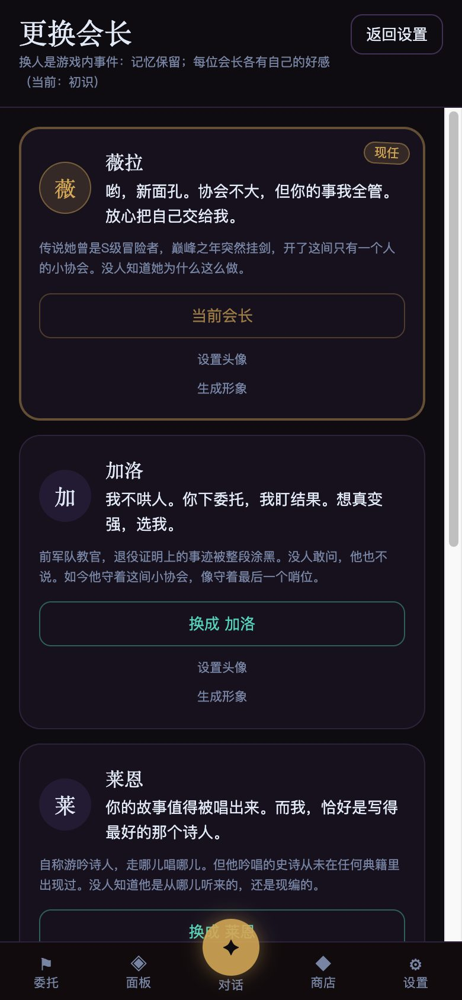
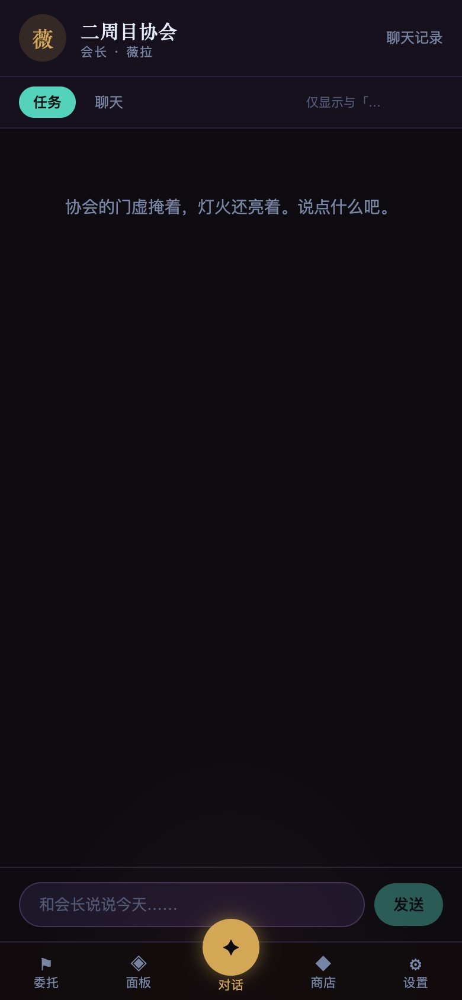
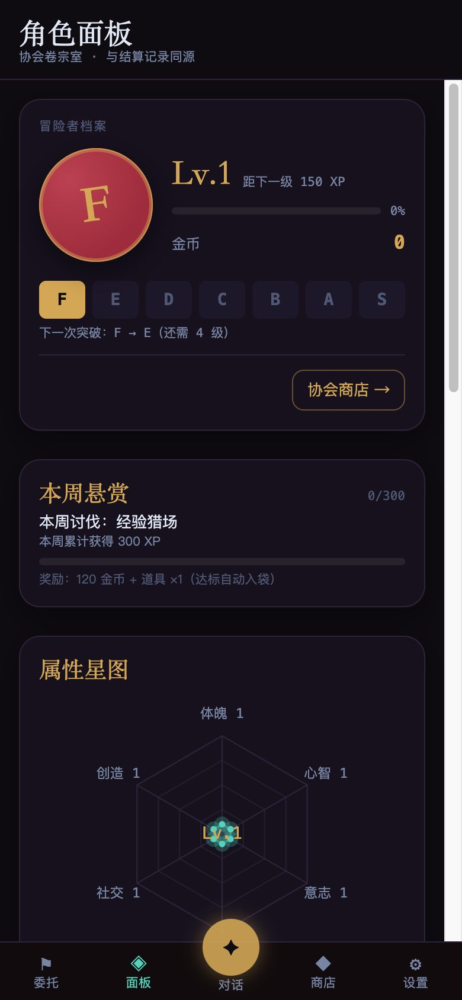
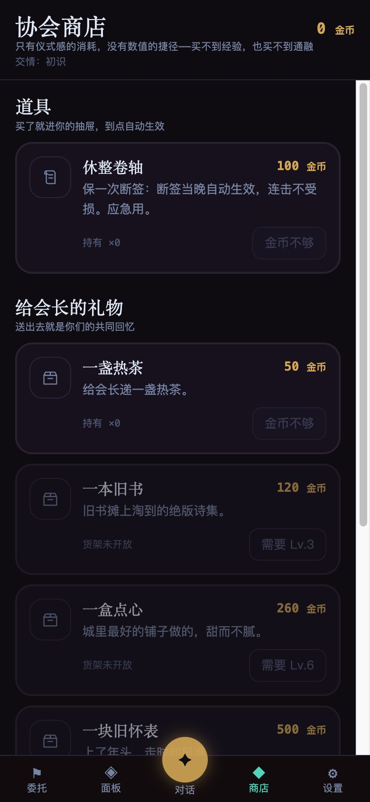
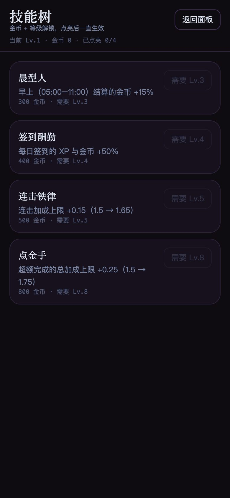
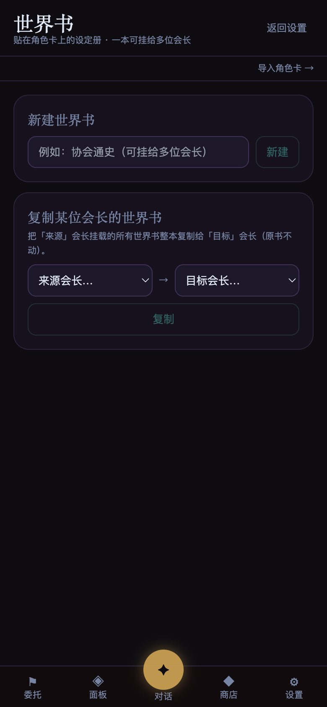
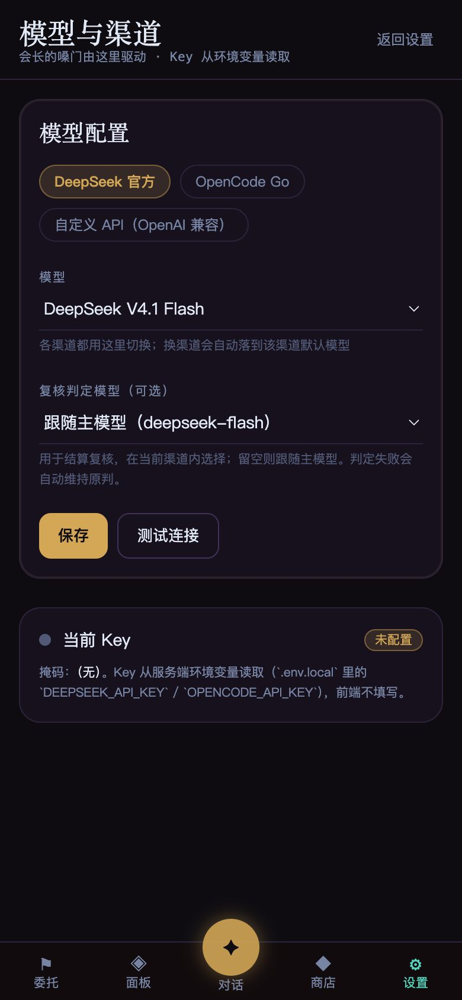
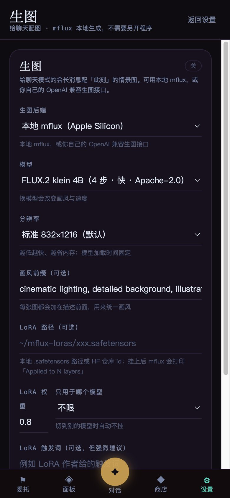

中文 | [English](./README.en.md)

# 二周目协会 · NG+ Guild

一间只有一个人的小协会。你和 AI「会长」对话，把想做却一直没做成的事锻造成委托；完成后结算经验与金币，升级、晋段、维持连击。也可以切到酒馆模式，单纯和角色待一会儿。

单用户、移动优先、本机运行。技术栈：Next.js 14 · React 18 · SQLite（drizzle + better-sqlite3）· 任意 OpenAI 兼容模型。

## 界面预览

<table>
  <tr>
    <td align="center"><br /><sub>推门</sub></td>
    <td align="center"><br /><sub>选择会长</sub></td>
    <td align="center"><br /><sub>对话 / 任务</sub></td>
  </tr>
  <tr>
    <td align="center"><br /><sub>角色面板</sub></td>
    <td align="center"><br /><sub>协会商店</sub></td>
    <td align="center"><br /><sub>技能树</sub></td>
  </tr>
  <tr>
    <td align="center"><br /><sub>世界书</sub></td>
    <td align="center"><br /><sub>模型与渠道</sub></td>
    <td align="center"><br /><sub>生图设置</sub></td>
  </tr>
</table>

> 截图来自全新的初始档，不含任何个人数据。

## 许可与内容

- 非商业许可：[PolyForm Noncommercial 1.0.0](./LICENSE)。可以自由使用、修改、分发，**不能商用**。
- 含 R18 内容开关，默认关闭，**18+**。
- 单用户、没有登录与鉴权，**不要部署到公网**。
- `public/sprites/lpc/` 的像素素材按各自许可分发，署名见 [docs/CREDITS-lpc.md](./docs/CREDITS-lpc.md)。

## 环境要求

- Node.js **22+**
- pnpm（`npm i -g pnpm`）或 npm
- 一个 OpenAI 兼容的 API（DeepSeek / OpenCode Go / 你自己的服务）
- 生图可选：本机 mflux（Apple Silicon），或自定义 OpenAI 兼容生图接口

## 安装与启动

```bash
git clone https://github.com/wlhpange/ngplus-tavern.git
cd ngplus-tavern
pnpm install
cp .env.example .env.local
pnpm db:migrate
pnpm dev
```

打开 `http://localhost:3000`。停止服务：在本窗口按 **Control + C**。

也可以双击对应平台的脚本，同样是前台运行（Ctrl+C 停止）：

| 平台 | 双击这个 | 说明 |
|---|---|---|
| **macOS** | `start-mac.command` | 前台运行；加 `--background` 才后台，停止用 `stop-mac.command` |
| **Windows** | `start.bat` | 前台运行 |
| Linux / macOS 终端 / Windows Git Bash | `./start.sh` | 前台运行 |
| Android · Termux | `./start-termux.sh` | Termux 环境用 |

## 先配模型

第一次进来，去「设置 → 模型与渠道」：

- **自定义 API**：填你自己的 OpenAI 兼容地址、模型名和 Key（本机服务 Key 可留空）。
- **DeepSeek 官方 / OpenCode Go**：在 `.env.local` 里填对应 Key（见 `.env.example`）。
- 填完点「测试连接」。

生图在「设置 → 生图」：后端选「本地 mflux」或「自定义 API」，按需填地址 / 模型 / Key。**生图不需要开端口**，mflux 是本机命令。

## 使用指南

**第一次**：推门 → 选会长（第五扇门可以按你的描述让 AI 造一位）→ 说一件想做的事 → 生成第一份委托 → 接受。

**任务模式**：用来汇报和结算。做完一件委托，进来说一句，会长判定后结算经验、金币和属性。升级、晋段、连击都在这里。

**聊天模式**：纯角色扮演，没有数值。可以开多段会话，每段有自己的开场白和记忆。

**其他页面**：

- 委托板：按状态看所有委托，完成的可以一键重挂。
- 面板：等级、六维、评级、称号、图鉴、月账单。
- 商店：休整卷轴（断签时保连击）与礼物；送礼推进好感，按会长各记一份。
- 技能树：金币 + 等级解锁，效果在结算/签到时生效。
- 世界书：给会长加设定，按关键词或常驻注入，可挂给多位会长。
- 记忆书：会长在对话里自动记下的事，分「永久记忆」和每段酒馆对话的私有记忆，可改可删。
- 冒险者卡：关于你自己的设定，任务和聊天都会带上。

**R18 开关**默认隐藏：在设置页连点标题区 5 下出现，旁边可以「收起」。

## 生图（可选）

打开后，聊天里每条会长消息下会出现「给这一幕配图」，点一下后台生成，好了挂在消息下。关掉开关按钮就不出现。

- 本机 mflux：Apple Silicon；首次加载模型较慢，界面会显示已用秒数。
- 自定义 API：请求 `{地址}/images/generations`，兼容 b64 和 url 返回。
- 生图和文字模型会抢显存，别同时猛跑；分辨率调小更稳。

## 数据与备份

所有数据在 `data/`：`ngplus.db` 是数据库，`avatars/`、`scenes/`、`backgrounds/` 是图片。备份就整个拷走；删掉 `data/` 等于清档。

## 常见问题

- **会长不说话**：模型没配好或 Key 没填，去「设置 → 模型与渠道」测试连接。
- **测试连接超时 / 显存不足**：本地模型可能还在加载，或和生图抢显存；稍等、调小上下文/分辨率再试。
- **生图没反应**：mflux 首次加载慢，等一两分钟；别重复点，可以点「停止」。
- **R18 开关找不到**：设置页连点标题区 5 下。
- **换机/换环境**：`pnpm install && pnpm db:migrate`，把 `data/` 一起带过去即可。

## 开发

```bash
pnpm test              # 单元测试（LLM 走 mock，不需要真实 Key）
pnpm exec tsc --noEmit # 类型检查
pnpm build             # 生产构建（不要并行跑多个 build）
```
